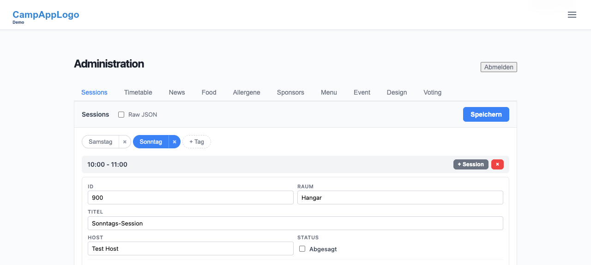
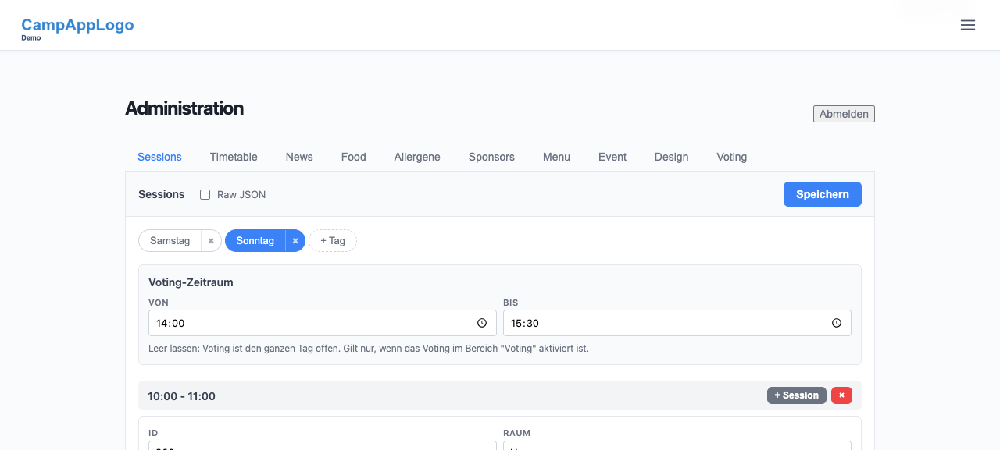
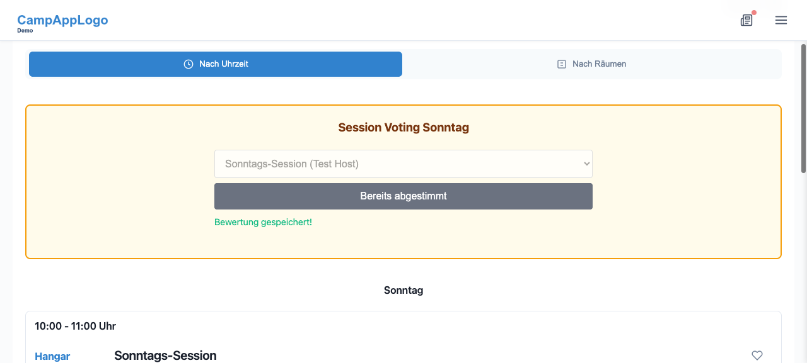

# F001 - Vorher/Nachher

## Admin, Tab Sessions, Tag Sonntag: neuer Block "Voting-Zeitraum"

**Vorher:**

**Nachher:**

Differenz: Oberhalb der Zeitslots steht je Tag der Block "Voting-Zeitraum" mit den Feldern Von/Bis und einem Hinweis.

## Sessionplan im gesetzten Zeitraum

Das Voting-Formular selbst ist unverändert. Ob es erscheint, entscheidet jetzt der Zeitraum je Tag. Kein Vorher-Bild, weil sich das Formular optisch nicht geändert hat.

